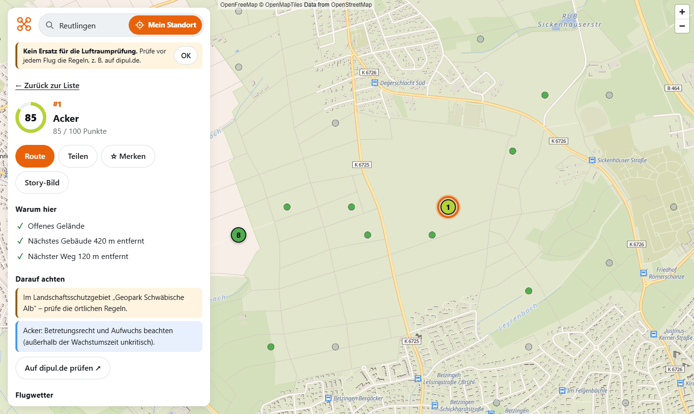
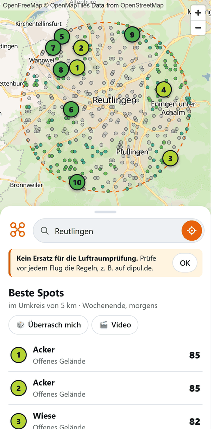

# FPV Spot Finder

**[fpv-finder.com](https://fpv-finder.com)** – find quiet places to fly your FPV
drone in Germany.

Enter a town or use your location: the finder rates the open land around you and
shows the best spots – with the reasons behind every spot, what to look out for,
the flight weather and a direct link to check the airspace. Free, no account, no
ads, no tracking.

  
  

> ⚖️ **Not a substitute for an airspace check.** The rating is a heuristic over
> incomplete open data, offered with no warranty. Verify the EU drone regulation
> (2019/947), national rules, NOTAMs and geographical UAS zones yourself before
> every flight – in Germany via [dipul.de](https://www.dipul.de/).

## What it does

- **Best spots nearby** – a ranked top ten on the map, on phone and desktop.
- **Why here, and what to watch out for** – open land, distance to buildings and
  paths; nature reserves, airfields, power lines, roads.
- **Flight weather** – wind, gusts, rain and the Kp index (GPS quality) at a glance.
- **Route, share, story image, GPX** – take a spot with you or send it to friends.
- **[Regions](https://fpv-finder.com/regionen/stuttgart) and [guides](https://fpv-finder.com/ratgeber)** –
  the best spots around 84 large cities, and where and how you may fly in Germany.

## How it works

The rating looks at OpenStreetMap: how open the land is, how far the nearest
buildings, paths and roads are, and how busy the area is likely to be at the
chosen time. Restricted areas such as nature reserves and airfield zones lower a
spot's score or rule it out. The map data is refreshed every month.

## Self-hosting and development

The whole thing runs in a single Docker container and fits a small server
(2 GB RAM, 1 CPU). See **[docs/self-hosting.md](docs/self-hosting.md)** for setup,
map data, options and the development workflow. What changed between versions:
[CHANGELOG.md](CHANGELOG.md).

## Licences

Code: [AGPL-3.0](LICENSE).

Map data © OpenStreetMap contributors, [ODbL](https://www.openstreetmap.org/copyright).
Map tiles: OpenFreeMap / OpenMapTiles. Weather: Open-Meteo (CC BY 4.0).
